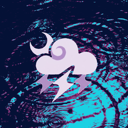

<p align="center">
  
</p>

<h1 align="center">Rainium</h1>

<p align="center">
  Any 3D model- objs, gltf, glb- now in Minecraft as a cosmetic. Away with painful blockbench conversions and import anything, with textures, materials, glows, and particles. Completely client side and customizable, for Fabric on the latest version.
</p>

<p align="center">
  <a href="https://github.com/raincandyfx/rainium/releases/latest"><b>Download the latest version</b></a>
</p>

> Rainium is in **beta** (0.x). Things may change between versions, and feedback is welcome in [Issues](https://github.com/raincandyfx/rainium/issues).

## What it does

- **Wear any 3D model.** Put wings on your back, a halo behind your head, a tail, ears or anything else. Import your own OBJ, glTF or GLB models right in the game.
- **Edit it live.** Press <kbd>K</kbd> and change textures, colours, glow, size, position and angle while watching your player update in real time. Everything saves automatically, and Undo is always there.
- **Natural movement.** Cosmetics trail behind you as you run and turn, and sway gently when you stand still. You can make each one as bouncy or as still as you like.
- **Wear it anywhere.** Attach each part to your body, head, arms or legs. Parts on your limbs swing with them, and a mirrored copy puts one on each side.
- **Particles.** Sparkles, embers, hearts, trails and auras, or your own particles from any PNG.
- **Pictures and recordings.** Save a transparent picture of your look, or record it as a smooth clip for videos.
- **Group parts into folders.** A model made of several parts stays together: switch it on or off, resize it or move it in one go.
- **Recolour with Hue and Tint.** Shift a texture's colours around the colour wheel, or tint the whole layer towards any colour, without editing the image.
- **Share your look.** Export a folder as a zip, and a friend can add it from the editor.
- **Just for you.** Rainium only changes what *you* see. It works on any server, and other players' setups never affect yours.
- **Keeps itself up to date.** New versions for your Minecraft version are downloaded and installed when you close the game (you can turn this off).

## Installing

1. Install [Fabric Loader](https://fabricmc.net/use/) for Minecraft **26.3**, **26.2** or **1.21.11**, plus [Fabric API](https://modrinth.com/mod/fabric-api).
2. From the [latest release](https://github.com/raincandyfx/rainium/releases/latest), download the jar for your Minecraft version (`rainium-<version>+26.3.jar`, `rainium-<version>+26.2.jar` or `rainium-<version>+1.21.11.jar`) and put it in your `.minecraft/mods` folder. (The `-sources` jars are source code, not the mod.)
3. Launch the game and press <kbd>K</kbd>.

[Mod Menu](https://modrinth.com/mod/modmenu) is optional; with it, Rainium's **Configure** button opens the editor too.

## Getting started

**Open the editor** with <kbd>K</kbd> (you can rebind it in Controls), the `/rainium` command, or Mod Menu.

**Try a sample model.** Open the **Add** tab and press **Add** on the Gold halo, the Glow halo or Nocturne. Click the square next to a layer in the list on the left to show or hide it.

**Add your own model.**
1. Click **Open rainium folder** (on the Add or Settings tab) and drop in your `.obj`, `.gltf` or `.glb` file, plus its `.png` texture if it has one (a texture inside a `.glb` is picked up automatically).
2. On the **Add** tab, click your model. A live preview appears on your player while you adjust its size, orientation and position.
3. Click **Add as layer** (or **Add as folder** if the model has several parts).

**Make it look right.** Select a layer on the left, then use the **Edit** tab:
- **Look:** texture, style (solid, see-through, glow), hue, tint and opacity.
- **Placement:** what it's attached to (body, head, body without leaning, or an arm or leg), size, position and angle.
- **Behaviour:** a mirrored copy (model one wing, get two), swaying with movement, hiding while gliding.
- **Shown on:** which players and armor stands this layer appears on.

Hover over any setting's name for a short explanation. Click any number to type an exact value, and use **Undo** / **Redo** in the top bar (or <kbd>Ctrl</kbd>+<kbd>Z</kbd> / <kbd>Ctrl</kbd>+<kbd>Y</kbd>).

**Hide everything quickly** with the **Showing** switch at the top of the editor.

## Models from other programs

The in-game import reads **OBJ**, **glTF** and **GLB** files, which nearly every 3D program can export. Blender exports work with the default settings.

To convert without opening the game, there are two converters in [`tools/`](tools):
- `obj-converter.html`: open it in your browser, drop in an OBJ and download the result. Your model never leaves your computer.
- `mesh_convert.py`: a command-line converter for OBJ, glTF and GLB (needs Python 3.8 or newer).

Your `config/rainium` folder also has a `README.txt` with the full details: the coordinate system, the mesh file formats and every option in `layers.json`.

## Particles

Besides models, a layer can be a **particle emitter**. On the **Add** tab, start from **Sparkles**, **Embers**, **Hearts**, **Trail**, **Aura** or an **Empty emitter**, then fine-tune it on the Edit tab:

- **Picture:** one of Minecraft's particles (flame, sparkle, heart, note, smoke, petal and more) or any PNG you put in the rainium folder. Style, hue, tint and opacity work like on models.
- **When and how many:** always, only while moving, only while standing still, or more the faster you move; how many per second and how long each lasts.
- **Where they appear:** a point, a ball, a box or a ring around the attachment point, at any size. Attach emitters to your body, head, arms or legs like any layer.
- **How they move:** direction, speed, spread, gravity (negative floats up), drag and spin, plus size over time and fading out. **Start angle** makes every particle start upright, or at a random angle.
- **Move with me:** particles either travel along with you or stay where they appeared, leaving a trail.

## Presets

| Preset | |
|---|---|
| **Gold halo** | Offered in the Add tab (a fresh setup starts empty). Its rungs glow in the dark. |
| **Glow halo** | A soft glowing ring over the head with pink sparkles. |
| **Nocturne** | A moon in a halo that turns in place beside your right arm, in two forms (**Base** and **Ascended**) shown under one heading. |
| **Eyed wings** | Greyed out (with a link to the mod's page) until a compatible wing mod is in your `mods` folder (keep it disabled, it crashes Rainium while enabled). Its files are read from that mod. |

Any layer can **Spin** (Edit > Behaviour): it turns around an upright axis at the speed you set, in degrees per second. **Spin around** picks the centre: the middle of the layer's own model, the player, a body part, or another layer (which makes it circle that layer while the other one stays put). In a set file: `"spin": 180, "spin_center": "layer:Moon"` (or `"anchor:head"`). Nocturne uses it: the parts turn slowly around their middle, and the moon turns the other way.

You can add a preset again at any time from the **Add** tab, and **Reset to preset** puts a part back the way it came.

## Reactions

A layer (or a whole folder) can react to what happens to the player wearing it: show for a few seconds when your opponent pops a totem, flash red when you're hit, glow while you're in combat, spin while you sprint. Open it with **Edit reactions** in the layer's or folder's panel. It's a full-screen node editor:

- **Events** (yellow) are moments, in groups:
  - **PvP:** totem pop (yours, and your opponent's: whoever you last hit or who last hit you in the last 15 s), double pop, mace smash, smashed by a mace, pearl thrown, pearl teleport, opponent pearled, chorus teleport, wind charge, launched, crystal hit, anchor blast, hit by a projectile, shot a player, disabled a shield, opponent's armour broke, golden apple, killed by a player, close call.
  - **Combat:** hit (players or mobs, any kind of damage), critical hit, sweep attack, kill, kill streak, assist, swing.
  - **Damage:** hurt (by any kind of damage), healed, knocked back, death, respawn, shield block, shield broken, armour broke, splashed.
  - **Movement:** jump, land, riptide, firework boost, into / out of water, changed dimension.
  - **Items:** shoot, eat or drink, effect gained / ended, block broken / placed, picked up, fishing catch, level up.
  - **World:** lightning nearby, a chat word, every few seconds.
- **States** (blue) are true for a while: health, absorption, on fire; in combat, blocking, falling; your opponent's health, distance, held item, shield, and whether they're looking at you; sneaking, sprinting, moving, gliding, swimming, in water or lava, on the ground, in the air, riding, sleeping, in a cobweb; holding or using an item, an effect, hunger, low durability, few totems left, an item cooling down, shield disabled; night, rain, thunder, a dimension, a biome, game mode.
- **Logic** (purple) combines and shapes them, in groups:
  - **State gates:** and, or, not, nand, nor, xor, xnor.
  - **Event gates:** either, both, then, without, one of. Both, then, without and one of have a **Tolerance**: how close in time the two events must be.
  - **State + event:** only while, unless.
  - **Convert:** stay on for, toggle, on/off, when it starts, when it stops. **Filter:** chance, cooldown, every Nth, combo, delay.
- **Actions** (pink) change the layer: show, hide, tint, opacity, glow, rainbow, size, move, rotate, spin, shake, bob, blink, flicker, colour and glow pulses, pulse, heartbeat, sway, orbit, drift, wobble, roll, shiver, glitch, and particle bursts on particle layers. Each fades in, holds (after an event) and fades out, with a curve for each way in and out (ease in/out, overshoot, elastic, bounce, step, or a custom curve with handles).

The add menu has a search bar (type to search every node) and a chip for each group. Drag from an output to an input to wire nodes; drop a wire on empty space to add a node already wired. ▶ on an event fires it on you, and the square on a state pretends it's on, so you can try things in the live preview. Hover or click an **i** for what a node does. There are ready-made examples to start from, and the tutorial (Settings > Replay tutorial) walks through the editor.

Reactions are saved with the layer, so **Export as zip** (and **Export layer**) carry them. **File** in the editor copies them as text, pastes them, or saves and loads `.reactions.json` files in `config/rainium/exports`. Your reactions show on everyone your layer is drawn on, each reacting to what happens to them; a few things (effects, hunger, eating, level-ups, durability, cooldowns, totems left, block breaking and placing, dimension changes) are only known about you.

## Lyrics

Rainium can show the lyrics of the song playing on your computer as a plane in the world, in time with the music. Switch it on in **Settings > Music and lyrics**. Only you see the lyrics.

- **What's playing:** on Windows, any player that shows in the volume flyout (Spotify, browsers, Apple Music...). On macOS, Spotify or Apple Music (macOS asks once to let Minecraft read them). On Linux, any player through `playerctl`.
- **Where the lyrics come from:**
  - Your own `.lrc` files, named `Artist - Title.lrc`, in `config/rainium/lyrics`.
  - Lyrics saved from an earlier lookup.
  - **lrclib.net**, a free lyrics site, but only if you switch on **Find lyrics online**. Only the song's title, artist, album and length are sent.
- **Looks:**
  - **Music video:** the lyrics as a lyric video in the manner of [JIZURA](https://github.com/852wa/JIZURA): twelve styles with its colours, chromatic ghosting, HUD frame, rings, slashes, kinetic type (39 of JIZURA's layouts ported to Java; each line gets its own layout and its own way in and out), plus optional Japanese motifs and glitch effects. It's drawn by Rainium itself, so there's nothing else to install.
  - **Simple:** the line being sung, filling in word by word, with the next line under it.
- **In the world:** each line is a plane fixed in the world, left and right of where you were looking when it started, a little in front of you. It stays there as you move and look around. If you turn away from it for a moment, or walk far from it, the next spot is in front of you again.
- **Never in the way:**
  - The lyrics never cover the one you're fighting, or the player or monster you're aiming at. They move to its left or right, with room to spare, and shrink if they must.
  - They're made to fit the screen, and they're small by default (Size is a percentage you type; Fixed or Follow-opponent placement, on the Lyrics page).
  - They never move your view or change the world.
  - **Through blocks** decides whether walls can hide them.
- **Sync** moves the lyrics earlier or later. **Demo song** plays a short built-in song (lyrics only) so you can try the looks without music. **Song in chat** adds a line to your chat (only you see it) when the song changes.

## Pictures and recordings

The preview in the editor has two buttons in its top corner:

- **Picture** saves a PNG of your player and cosmetics with a transparent background.
- **● Rec** records the preview until you click **Stop**, as numbered PNG frames with a transparent background (`frame_00001.png`, `frame_00002.png` ...).

Both land in `config/rainium/captures` (**Settings > Capture > Open captures folder**). What you see is what you get: set up the angle and zoom first. In **Settings > Capture** you can choose the size (the preview's size on screen, 2× or 4×), the frame rate (120 by default, or 60 or 30) and a slow or fast spin while recording. Recordings always play back smoothly and at true speed at the chosen frame rate. While recording, the game's clock follows the recording instead of real time: every frame the game draws becomes the next frame of the clip, exactly one step after the last, including emotes from mods like Emotecraft. Your frame rate doesn't matter; the game just runs faster or slower than normal until you stop.

Each recording's folder name ends with its frame rate, like `rainium_2026-10-24_11-40-00_120fps`. Video editors such as DaVinci Resolve, Premiere, After Effects, CapCut and Blender import a folder of frames as one clip with transparency (choose "image sequence" and that frame rate). To turn the frames into a single video file with transparency, [ffmpeg](https://ffmpeg.org) can do it from inside the folder:

```
ffmpeg -framerate 120 -i frame_%05d.png -c:v libvpx-vp9 -pix_fmt yuva420p clip.webm
```

## Sharing a look

Open a folder in the layer list and click **Export as zip**. The zip lands in `config/rainium/exports`, with the models and textures it uses. Send it to a friend; they put it in their `config/rainium` folder and add it from **Add > Shared sets**. Your **Shown on** choices (and any names in them) stay with you, not in the zip.

## Updates

Once per launch, Rainium checks this page's releases for a newer version made for your Minecraft version. If there is one, it downloads it, checks it, and installs it when you close the game. Your layers and settings are kept.

You can turn this off, see the status, or check right away in **Settings > Updates**. Checking means your game contacts GitHub, which can see your IP address.

Only main releases (versions ending in **.0**, like 0.7.0) are installed automatically. Releases marked **dev build** (0.7.1, 0.7.2 ...) are early test versions: you can download them by hand from the releases page, or switch on **Include dev builds** in **Settings > Updates** to get them automatically too.

## Privacy

Rainium doesn't collect or send anything about you. Its only network requests are the optional update check above and, if you switch on **Find lyrics online**, looking up the song you're playing on lrclib.net (title, artist, album and length only).

When the editor shows a folder path, it replaces your computer's account name with your in-game name, so it's safe to share screenshots. You can choose a different name, or hide it entirely, in **Settings > Privacy**.

## Questions

**Can other players see my cosmetics?**
No. Rainium is a personal, client-side cosmetic, so only you see what you set up. To share a look, send someone your files or an exported zip.

**Can I put my cosmetics on friends or on an armor stand?**
On your screen, yes. In **Settings > Visibility**, **Show on** can include everyone, other players, or a list of player names, and **Armor stands** shows them on armor stands with a name tag you choose (for screenshots and displays). Nobody else sees this.

Each layer and folder can also choose for itself under **Shown on** on the Edit tab, for example wings just on you and a halo on an armor stand named "Display". Left on **Default**, it follows its folder, then Settings.

**Does it work in Flashback replays?**
Yes. In a replay you watch through a camera, so tell Rainium which recorded player is you: open the editor during the replay, go to **Settings > Visibility**, and click **+ Me** next to yourself under **Players here**, or paste the entity UUID Flashback shows for you into **Also me** (<kbd>Ctrl</kbd>+<kbd>V</kbd>). Players listed there get your **Just me** layers. If nobody is listed, Rainium tries to work it out (your account name, the only player with a recorded hotbar, or the player nearest the camera at the start).

**Does it work on servers?**
Yes. It only runs on your side, so it works on any server and nothing needs to be installed there.

**Something looks wrong after I edited a file by hand.**
Rainium keeps showing your last working setup and explains the problem at the top of the editor (and in **Settings**). Fix the file, or click **Reload**.

**Where are my files?**
In `.minecraft/config/rainium/`. **Open rainium folder** in the editor takes you there.

**Can I translate it?**
Yes, please! Copy [`en_us.json`](src/main/resources/assets/rainium/lang/en_us.json) to your language's code (for example `de_de.json` or `pt_br.json`), translate the text on the right of each line, and send it in an [issue](https://github.com/raincandyfx/rainium/issues). `%s` marks where a name or number goes.

## Disclaimer

Some of the sample models that come with the mod, and the models worn in the character recordings on the website, are based on designs from other works:

- **Gold halo**, **Nocturne** (both forms) and **dark red wings** (Eyed wings): *Genshin Impact* (© Cognosphere PTE. LTD., HoYoverse)
- **Floating pod**: *NieR:Automata* (Square Enix)
- **Long red spear**: "[Lance of Longinus](https://skfb.ly/6Rxyq)" by Mr. The Rich, licensed under [Creative Commons Attribution 4.0](http://creativecommons.org/licenses/by/4.0/). The weapon's original design is from *Neon Genesis Evangelion* (© khara)
- **Small doll**: a MySekai item from *HATSUNE MIKU: COLORFUL STAGE!* (© SEGA, © Colorful Palette Inc., © Crypton Future Media, Inc.)

The characters in the recordings are animated with emotes by Milyan-SPEmotes, played with [Emotecraft](https://modrinth.com/mod/emotecraft); the animations aren't part of Rainium. One of them is based on the dance from the *HATSUNE MIKU: COLORFUL STAGE!* version of "Heat Abnormal" (song by Iyowa).

Rainium is not affiliated with, endorsed by or connected to any of these companies or the original creators, and all rights to the original designs belong to them. They're shown only as examples of what the mod can display.

Not an official Minecraft product. Not approved by or associated with Mojang or Microsoft.

## License

Rainium is open source under the [MIT License](LICENSE).

The lyric video look is a re-creation in Java of the style of [JIZURA](https://github.com/852wa/JIZURA) (MIT License, © 2026 hakoniwa); 31 of its layouts are ported from its source. Its colour palettes and which motion each style prefers are taken from JIZURA's style table (`assets/rainium/jizura/styles.json`), included with JIZURA's license. Rainium doesn't run JIZURA itself.
