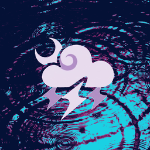

<p align="center">
  
</p>

<h1 align="center">Rainium</h1>

<p align="center">
  Any 3D model- objs, gltf, glb- now in Minecraft as a cosmetic. Away with painful blockbench conversions and import anything, with textures, materials, glows, and particles. Completely client side and customizable, for Fabric on the latest version.
</p>

<p align="center">
  <a href="https://github.com/raincandyfx/rainium/releases/latest"><b>Download the latest version</b></a>
</p>

> Rainium is in **beta** (0.x). Things may change between versions, and feedback is welcome in [Issues](https://github.com/raincandyfx/rainium/issues).

## What it does

- **Wear any 3D model.** Put wings on your back, a halo behind your head, a tail, ears or anything else. Import your own OBJ, glTF or GLB models right in the game.
- **Edit it live.** Press <kbd>K</kbd> and change textures, colours, glow, size, position and angle while watching your player update in real time. Everything saves automatically, and Undo is always there.
- **Natural movement.** Cosmetics trail behind you as you run and turn, and sway gently when you stand still. You can make each one as bouncy or as still as you like.
- **Wear it anywhere.** Attach each part to your body, head, arms or legs. Parts on your limbs swing with them, and a mirrored copy puts one on each side.
- **Particles.** Sparkles, embers, hearts, trails and auras, or your own particles from any PNG.
- **Pictures and recordings.** Save a transparent picture of your look, or record it as a smooth clip for videos.
- **Group parts into folders.** A model made of several parts stays together: switch it on or off, resize it or move it in one go.
- **Recolour with Hue and Tint.** Shift a texture's colours around the colour wheel, or tint the whole layer towards any colour, without editing the image.
- **Share your look.** Export a folder as a zip, and a friend can add it from the editor.
- **Just for you.** Rainium only changes what *you* see. It works on any server, and other players' setups never affect yours.
- **Keeps itself up to date.** New versions for your Minecraft version are downloaded and installed when you close the game (you can turn this off).

## Installing

1. Install [Fabric Loader](https://fabricmc.net/use/) for Minecraft **26.3**, **26.2** or **1.21.11**, plus [Fabric API](https://modrinth.com/mod/fabric-api).
2. From the [latest release](https://github.com/raincandyfx/rainium/releases/latest), download the jar for your Minecraft version (`rainium-<version>+26.3.jar`, `rainium-<version>+26.2.jar` or `rainium-<version>+1.21.11.jar`) and put it in your `.minecraft/mods` folder. (The `-sources` jars are source code, not the mod.)
3. Launch the game and press <kbd>K</kbd>.

[Mod Menu](https://modrinth.com/mod/modmenu) is optional; with it, Rainium's **Configure** button opens the editor too.

## Getting started

**Open the editor** with <kbd>K</kbd> (you can rebind it in Controls), the `/rainium` command, or Mod Menu.

**Try the example halo.** Rainium comes with a Gold halo that starts switched off. In the layer list on the left, click the square next to **Gold halo** to show it.

**Add your own model.**
1. Click **Open rainium folder** (on the Add or Settings tab) and drop in your `.obj`, `.gltf` or `.glb` file, plus its `.png` texture if it has one (a texture inside a `.glb` is picked up automatically).
2. On the **Add** tab, click your model. A live preview appears on your player while you adjust its size, orientation and position.
3. Click **Add as layer** (or **Add as folder** if the model has several parts).

**Make it look right.** Select a layer on the left, then use the **Edit** tab:
- **Look:** texture, style (solid, see-through, glow), hue, tint and opacity.
- **Placement:** what it's attached to (body, head, body without leaning, or an arm or leg), size, position and angle.
- **Behaviour:** a mirrored copy (model one wing, get two), swaying with movement, hiding while gliding.
- **Shown on:** which players and armor stands this layer appears on.

Hover over any setting's name for a short explanation. Click any number to type an exact value, and use **Undo** / **Redo** in the top bar (or <kbd>Ctrl</kbd>+<kbd>Z</kbd> / <kbd>Ctrl</kbd>+<kbd>Y</kbd>).

**Hide everything quickly** with the **Showing** switch at the top of the editor.

## Models from other programs

The in-game import reads **OBJ**, **glTF** and **GLB** files, which nearly every 3D program can export. Blender exports work with the default settings.

To convert without opening the game, there are two converters in [`tools/`](tools):
- `obj-converter.html`: open it in your browser, drop in an OBJ and download the result. Your model never leaves your computer.
- `mesh_convert.py`: a command-line converter for OBJ, glTF and GLB (needs Python 3.8 or newer).

Your `config/rainium` folder also has a `README.txt` with the full details: the coordinate system, the mesh file formats and every option in `layers.json`.

## Particles

Besides models, a layer can be a **particle emitter**. On the **Add** tab, start from **Sparkles**, **Embers**, **Hearts**, **Trail**, **Aura** or an **Empty emitter**, then fine-tune it on the Edit tab:

- **Picture:** one of Minecraft's particles (flame, sparkle, heart, note, smoke, petal and more) or any PNG you put in the rainium folder. Style, hue, tint and opacity work like on models.
- **When and how many:** always, only while moving, only while standing still, or more the faster you move; how many per second and how long each lasts.
- **Where they appear:** a point, a ball, a box or a ring around the attachment point, at any size. Attach emitters to your body, head, arms or legs like any layer.
- **How they move:** direction, speed, spread, gravity (negative floats up), drag and spin, plus size over time and fading out. **Start angle** makes every particle start upright, or at a random angle.
- **Move with me:** particles either travel along with you or stay where they appeared, leaving a trail.

## Presets

| Preset | |
|---|---|
| **Gold halo** | Comes with the mod. It's set up on first launch but switched off, and its rungs glow in the dark. |
| **Eyed wings** | Greyed out (with a link to the mod's page) until a compatible wing mod is in your `mods` folder (it can be disabled). Its files are read from that mod. |

You can add a preset again at any time from the **Add** tab, and **Reset to preset** puts a part back the way it came.

## Pictures and recordings

The preview in the editor has two buttons in its top corner:

- **Picture** saves a PNG of your player and cosmetics with a transparent background.
- **● Rec** records the preview until you click **Stop**, as numbered PNG frames with a transparent background (`frame_00001.png`, `frame_00002.png` ...).

Both land in `config/rainium/captures` (**Settings > Capture > Open captures folder**). What you see is what you get: set up the angle and zoom first. In **Settings > Capture** you can choose the size (the preview's size on screen, 2× or 4×), the frame rate (120 by default, or 60 or 30) and a slow or fast spin while recording. Recordings always play back smoothly and at true speed at the chosen frame rate. While recording, the game's clock follows the recording instead of real time: every frame the game draws becomes the next frame of the clip, exactly one step after the last, including emotes from mods like Emotecraft. Your frame rate doesn't matter; the game just runs faster or slower than normal until you stop.

Each recording's folder name ends with its frame rate, like `rainium_2026-10-24_11-40-00_120fps`. Video editors such as DaVinci Resolve, Premiere, After Effects, CapCut and Blender import a folder of frames as one clip with transparency (choose "image sequence" and that frame rate). To turn the frames into a single video file with transparency, [ffmpeg](https://ffmpeg.org) can do it from inside the folder:

```
ffmpeg -framerate 120 -i frame_%05d.png -c:v libvpx-vp9 -pix_fmt yuva420p clip.webm
```

## Sharing a look

Open a folder in the layer list and click **Export as zip**. The zip lands in `config/rainium/exports`, with the models and textures it uses. Send it to a friend; they put it in their `config/rainium` folder and add it from **Add > Shared sets**. Your **Shown on** choices (and any names in them) stay with you, not in the zip.

## Updates

Once per launch, Rainium checks this page's releases for a newer version made for your Minecraft version. If there is one, it downloads it, checks it, and installs it when you close the game. Your layers and settings are kept.

You can turn this off, see the status, or check right away in **Settings > Updates**. Checking means your game contacts GitHub, which can see your IP address.

Only main releases (versions ending in **.0**, like 0.7.0) are installed automatically. Releases marked **dev build** (0.7.1, 0.7.2 ...) are early test versions: you can download them by hand from the releases page, or switch on **Include dev builds** in **Settings > Updates** to get them automatically too.

## Privacy

Rainium doesn't collect or send anything about you. Its only network request is the optional update check above.

When the editor shows a folder path, it replaces your computer's account name with your in-game name, so it's safe to share screenshots. You can choose a different name, or hide it entirely, in **Settings > Privacy**.

## Questions

**Can other players see my cosmetics?**
No. Rainium is a personal, client-side cosmetic, so only you see what you set up. To share a look, send someone your files or an exported zip.

**Can I put my cosmetics on friends or on an armor stand?**
On your screen, yes. In **Settings > Visibility**, **Show on** can include everyone, other players, or a list of player names, and **Armor stands** shows them on armor stands with a name tag you choose (for screenshots and displays). Nobody else sees this.

Each layer and folder can also choose for itself under **Shown on** on the Edit tab, for example wings just on you and a halo on an armor stand named "Display". Left on **Default**, it follows its folder, then Settings.

**Does it work in Flashback replays?**
Yes. In a replay you watch through a camera, so tell Rainium which recorded player is you: open the editor during the replay, go to **Settings > Visibility**, and click **+ Me** next to yourself under **Players here**, or paste the entity UUID Flashback shows for you into **Also me** (<kbd>Ctrl</kbd>+<kbd>V</kbd>). Players listed there get your **Just me** layers. If nobody is listed, Rainium tries to work it out (your account name, the only player with a recorded hotbar, or the player nearest the camera at the start).

**Does it work on servers?**
Yes. It only runs on your side, so it works on any server and nothing needs to be installed there.

**Something looks wrong after I edited a file by hand.**
Rainium keeps showing your last working setup and explains the problem at the top of the editor (and in **Settings**). Fix the file, or click **Reload**.

**Where are my files?**
In `.minecraft/config/rainium/`. **Open rainium folder** in the editor takes you there.

**Can I translate it?**
Yes, please! Copy [`en_us.json`](src/main/resources/assets/rainium/lang/en_us.json) to your language's code (for example `de_de.json` or `pt_br.json`), translate the text on the right of each line, and send it in an [issue](https://github.com/raincandyfx/rainium/issues). `%s` marks where a name or number goes.

## Disclaimer

The Gold halo example that comes with the mod, and the models worn in the character recordings on the website, are based on designs from other works:

- **Gold halo** and **dark red wings**: *Genshin Impact* (HoYoverse)
- **Floating pod**: *NieR:Automata* (Square Enix)
- **Long red spear**: "[Lance of Longinus](https://skfb.ly/6Rxyq)" by Mr. The Rich, licensed under [Creative Commons Attribution 4.0](http://creativecommons.org/licenses/by/4.0/). The weapon's original design is from *Neon Genesis Evangelion* (© khara)
- **Small doll**: a MySekai item from *HATSUNE MIKU: COLORFUL STAGE!* (© SEGA, © Colorful Palette Inc., © Crypton Future Media, Inc.)

The characters in the recordings are animated with emotes by Milyan-SPEmotes, played with [Emotecraft](https://modrinth.com/mod/emotecraft); the animations aren't part of Rainium. One of them is based on the dance from the *HATSUNE MIKU: COLORFUL STAGE!* version of "Heat Abnormal" (song by Iyowa).

Rainium is not affiliated with, endorsed by or connected to any of these companies or the original creators, and all rights to the original designs belong to them. They're shown only as examples of what the mod can display.

Not an official Minecraft product. Not approved by or associated with Mojang or Microsoft.

## License

Rainium is open source under the [MIT License](LICENSE).
